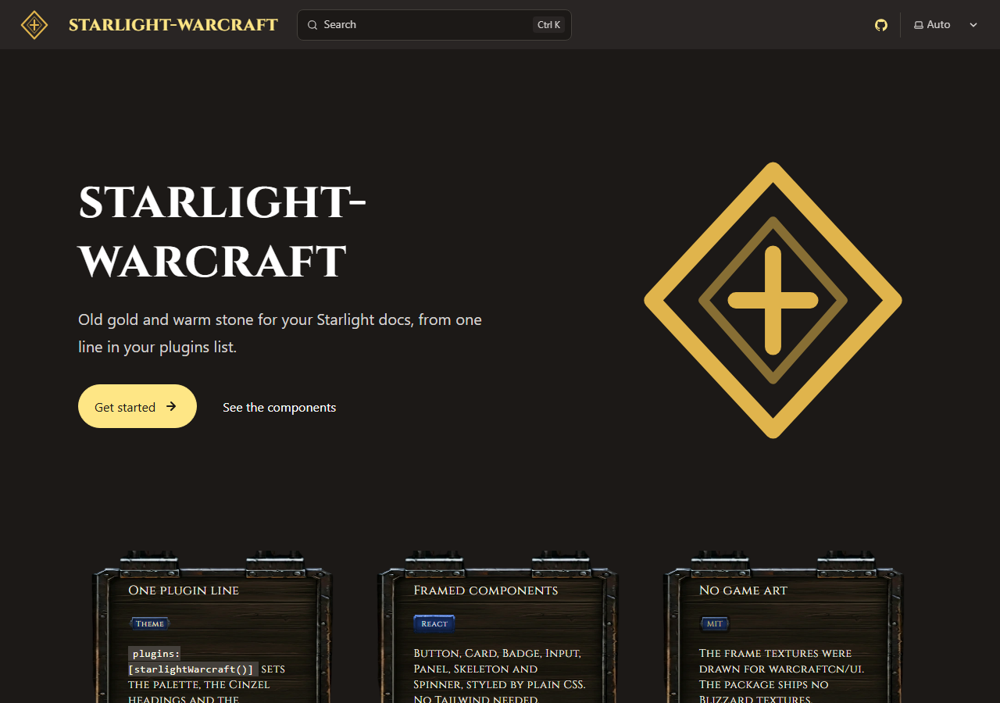
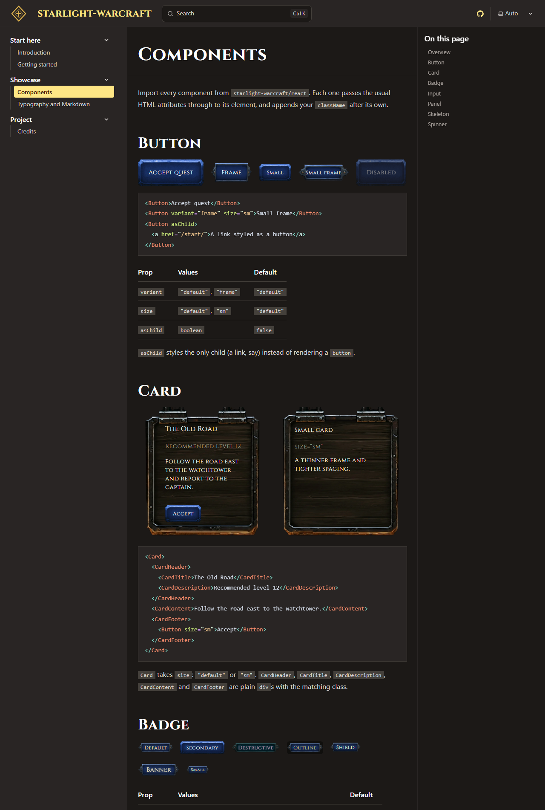
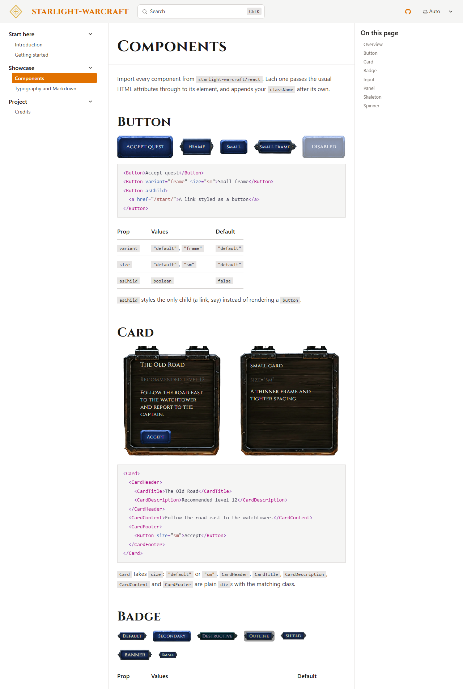

<h1 align="center">starlight-warcraft</h1>

<p align="center">
  <a href="https://github.com/Braden1996/starlight-warcraft/actions/workflows/ci.yml"></a>
  <a href="https://www.npmjs.com/package/starlight-warcraft"></a>
  <a href="https://github.com/Braden1996/starlight-warcraft/blob/main/LICENSE"></a>
  <a href="https://braden1996.github.io/starlight-warcraft/"></a>
</p>

**A fantasy theme for [Starlight](https://starlight.astro.build), from one line in your `plugins` list.** It turns
Starlight's accent to old gold and its greys to warm stone, sets headings in Cinzel, and ships framed React components
(Button, Card, Badge, Input, Panel, Skeleton and Spinner) forked from
[warcraftcn/ui](https://github.com/TheOrcDev/warcraftcn-ui). The components use plain CSS, so your site does not need
Tailwind.

**[See the demo site →](https://braden1996.github.io/starlight-warcraft/)**

<p align="center">
  
</p>

| Dark                                                                                                                                                            | Light                                                                                                                                                             |
| --------------------------------------------------------------------------------------------------------------------------------------------------------------- | ----------------------------------------------------------------------------------------------------------------------------------------------------------------- |
|  |  |

## Contents

- [Install](#install)
- [Add the theme](#add-the-theme)
- [Use the components](#use-the-components)
- [Cascade layers](#cascade-layers)
- [Design tokens](#design-tokens)
- [Without Starlight](#without-starlight)
- [Development](#development)
- [Credits and licence](#credits-and-licence)

## Install

```sh
bun add starlight-warcraft
```

The package ships TypeScript and CSS sources, which Astro compiles with your site, so it has no build step. It needs
Node 26 or newer, Astro 7 and Starlight 0.43 or newer. Each release is also attached to its
[GitHub release](https://github.com/Braden1996/starlight-warcraft/releases) as a tarball with a `SHA256SUMS` file, and
npm versions carry provenance from the release workflow.

## Add the theme

```ts
import starlight from "@astrojs/starlight";
import { defineConfig } from "astro/config";
import starlightWarcraft from "starlight-warcraft";

export default defineConfig({
  integrations: [
    starlight({
      title: "My docs",
      plugins: [starlightWarcraft()],
    }),
  ],
});
```

The plugin puts its stylesheets before your own `customCss`. It sets:

- Starlight's accent to old gold and its greys to warm stone, in dark and light mode;
- page titles, Markdown headings (`h1` to `h3`) and the site title in Cinzel, self-hosted through `@fontsource/cinzel`;
- the classes the React components use.

| Option  | Default | What it does                                                                        |
| ------- | ------- | ----------------------------------------------------------------------------------- |
| `fonts` | `true`  | Load Cinzel (400 and 700) from `@fontsource/cinzel`. Set `false` to bring your own. |

## Use the components

The components are React, so the site also needs
[`@astrojs/react`](https://docs.astro.build/en/guides/integrations-guide/react/). Import them from
`starlight-warcraft/react`:

```tsx
import { Badge, Button, Card, CardContent, CardHeader, CardTitle } from "starlight-warcraft/react";

<Card>
  <CardHeader>
    <CardTitle>The Old Road</CardTitle>
  </CardHeader>
  <CardContent>
    <Badge size="sm">Level 12</Badge> Follow the road east to the watchtower.
  </CardContent>
</Card>;
```

| Component                                                                 | Props beyond the element's own                                                                                                                                |
| ------------------------------------------------------------------------- | ------------------------------------------------------------------------------------------------------------------------------------------------------------- |
| `Button`                                                                  | `variant`: `"default"` or `"frame"`; `size`: `"default"` or `"sm"`; `asChild`: style the only child (a link, say) instead of a button.                        |
| `Card`                                                                    | `size`: `"default"` or `"sm"`.                                                                                                                                |
| `CardHeader`, `CardTitle`, `CardDescription`, `CardContent`, `CardFooter` | None.                                                                                                                                                         |
| `Badge`                                                                   | `variant`: `"default"`, `"secondary"`, `"destructive"` or `"outline"`; `size`: `"default"`, `"sm"` or `"lg"`; `shape`: `"default"`, `"shield"` or `"banner"`. |
| `Input`                                                                   | None.                                                                                                                                                         |
| `Panel`                                                                   | `quality`: `"common"`, `"uncommon"`, `"rare"`, `"epic"` or `"legendary"`. `panelClassName(quality)` gives the same classes for your own elements.             |
| `Skeleton`                                                                | None.                                                                                                                                                         |
| `Spinner`                                                                 | None. It has `role="status"` and the label "Loading" unless you pass `aria-label`.                                                                            |

Every component passes its element's usual attributes through and appends your `className` after its own. The
[components page](https://braden1996.github.io/starlight-warcraft/guides/components/) shows each one.

## Cascade layers

Every rule is in the `starlight-warcraft` cascade layer, which the theme declares straight after Starlight's own
`starlight` layer. So:

- CSS you write outside a layer overrides the theme;
- if you declare your own layer order (Tailwind sites do, for example
  `@layer base, starlight, theme, components, utilities;`), every layer you add comes after the theme and overrides it.

## Design tokens

The tokens are CSS custom properties on `:root`. Override them in your own CSS.

| Token                              | Use                                      |
| ---------------------------------- | ---------------------------------------- |
| `--wc-gold-50` … `--wc-gold-950`   | The accent scale                         |
| `--wc-stone-50` … `--wc-stone-950` | The grey scale                           |
| `--wc-font-display`                | Headings and component text (Cinzel)     |
| `--wc-ring`                        | Focus rings on buttons and inputs        |
| `--wc-card-foreground`             | Text on the dark frame textures          |
| `--wc-muted-foreground`            | Card descriptions and input placeholders |
| `--wc-destructive`                 | Destructive accents                      |

## Without Starlight

The components work in any React app. Import the stylesheets yourself:

```ts
import "starlight-warcraft/styles/fonts.css";
import "starlight-warcraft/styles/tokens.css";
import "starlight-warcraft/styles/components.css";
```

The spinner switches to its dark-mode glow under `[data-theme="dark"]` or `.dark`.

## Development

```sh
mise install
mise exec -- bun install
mise exec -- moon run :check
```

| Folder                         | What it is                                                 |
| ------------------------------ | ---------------------------------------------------------- |
| `packages/starlight-warcraft/` | The package: the plugin, the React components and the CSS. |
| `demo/`                        | The demo site, deployed to GitHub Pages from `main`.       |

[CONTRIBUTING.md](https://github.com/Braden1996/starlight-warcraft/blob/main/CONTRIBUTING.md) has the house style and the release steps.

## Credits and licence

starlight-warcraft is MIT-licensed ([LICENSE](https://github.com/Braden1996/starlight-warcraft/blob/main/LICENSE)).

- The components, the skeleton and spinner styles and the frame textures are forked from
  [warcraftcn/ui](https://github.com/TheOrcDev/warcraftcn-ui) by TheOrcDev (MIT). The fork and its changes are listed
  in [NOTICE.md](https://github.com/Braden1996/starlight-warcraft/blob/main/packages/starlight-warcraft/NOTICE.md); the upstream licence is in
  [LICENSE-warcraftcn.md](https://github.com/Braden1996/starlight-warcraft/blob/main/packages/starlight-warcraft/LICENSE-warcraftcn.md). Both ship in the npm package.
- [Cinzel](https://fontsource.org/fonts/cinzel) by Natanael Gama is under the SIL Open Font License 1.1, installed
  from `@fontsource/cinzel`.
- The frame textures were drawn for warcraftcn/ui. The package contains no Blizzard Entertainment game art.

This is an unofficial community project. Warcraft and World of Warcraft are trademarks of Blizzard Entertainment,
Inc. This project is not affiliated with or endorsed by Blizzard Entertainment.
